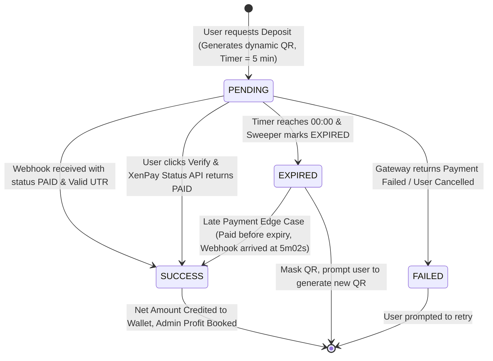

# Crazy Wallet: Financial Mathematics, System Architecture & State Machine Specification

## 1. Financial Mathematics & Formulas

### 1.1 Fee Configuration Constants
| Parameter | Notation | Rate / Fee |
| :--- | :--- | :--- |
| **Admin Fee Percentage** | $R_{admin}$ | $20\% = 0.20$ |
| **Admin Fixed Fee** | $F_{admin}$ | ₹15.00 |
| **XenPay Gateway Fee Percentage** | $R_{gateway}$ | $14\% = 0.14$ |
| **XenPay Fixed Fee** | $F_{gateway}$ | ₹10.00 |

---

### 1.2 Deposit Calculations
Let $D$ = Gross Deposit Amount paid by Creator (INR).

1. **Admin Fee Deducted from Creator**:
   $$Fee_{admin} = (D \times 0.20) + 15.00$$

2. **Net Credited to Creator's Wallet**:
   $$Net_{deposit} = D - Fee_{admin} = D - (0.20 D + 15.00) = 0.80 D - 15.00$$

3. **XenPay Processing Cost Incurred by Admin**:
   $$Cost_{xenpay} = (D \times 0.14) + 10.00$$

4. **Net Gateway Settlement to Admin**:
   $$Settlement_{gateway} = D - Cost_{xenpay} = D - (0.14 D + 10.00) = 0.86 D - 10.00$$

5. **Admin Net Profit per Deposit**:
   $$Profit_{admin} = Fee_{admin} - Cost_{xenpay} = (0.20 D + 15.00) - (0.14 D + 10.00) = 0.06 D + 5.00$$
   *Verification against Net Flow*:
   $$Profit_{admin} = Settlement_{gateway} - Net_{deposit} = (0.86 D - 10.00) - (0.80 D - 15.00) = 0.06 D + 5.00$$

#### Numerical Examples (Deposits)
| Gross Deposit ($D$) | Admin Fee ($20\% + ₹15$) | Net Credited to Creator ($0.80 D - 15$) | XenPay Cost ($14\% + ₹10$) | Admin Net Profit ($6\% + ₹5$) |
| :---: | :---: | :---: | :---: | :---: |
| **₹100.00** | ₹35.00 | ₹65.00 | ₹24.00 | **₹11.00** |
| **₹500.00** | ₹115.00 | ₹385.00 | ₹80.00 | **₹35.00** |
| **₹1,000.00** | ₹215.00 | ₹785.00 | ₹150.00 | **₹65.00** |
| **₹5,000.00** | ₹1,015.00 | ₹3,985.00 | ₹710.00 | **₹305.00** |
| **₹10,000.00** | ₹2,015.00 | ₹7,985.00 | ₹1,410.00 | **₹605.00** |

---

### 1.3 Withdrawal Calculations
Let $W$ = Requested Withdrawal Amount from Creator's Withdrawable Balance (INR).
When a creator requests withdrawal of $W$, their wallet balance is debited by $W$.

1. **Admin Withdrawal Fee Deducted**:
   $$Fee_{admin\_w} = (W \times 0.20) + 15.00$$

2. **Net Disbursed Payout to Creator's Bank / UPI**:
   $$Net_{payout} = W - Fee_{admin\_w} = W - (0.20 W + 15.00) = 0.80 W - 15.00$$

3. **XenPay Payout Gateway Fee**:
   - **Model A (XenPay charges based on Gross Requested Amount $W$)**:
     $$Cost_{xenpay\_w} = (W \times 0.14) + 10.00$$
     $$Profit_{admin\_w} = Fee_{admin\_w} - Cost_{xenpay\_w} = 0.06 W + 5.00$$
   - **Model B (XenPay charges based on Net Disbursed Payout $Net_{payout}$)**:
     $$Cost_{xenpay\_w} = (Net_{payout} \times 0.14) + 10.00 = 0.14(0.80 W - 15) + 10 = 0.112 W + 7.90$$
     $$Profit_{admin\_w} = Fee_{admin\_w} - Cost_{xenpay\_w} = (0.20 W + 15) - (0.112 W + 7.90) = 0.088 W + 7.10$$

*Note: In standard Indian payout APIs (XenPay/Cashfree/RazorpayX), payout gateway charges are typically assessed on the disbursed amount (Model B) or a flat slab. We provide both calculations; by default Model A guarantees an identical $6\% + ₹5$ margin.*

#### Numerical Examples (Withdrawals - Model A)
| Requested ($W$) | Admin Fee ($20\% + ₹15$) | Net Payout to Creator | XenPay Cost ($14\% + ₹10$) | Admin Net Profit |
| :---: | :---: | :---: | :---: | :---: |
| **₹100.00** | ₹35.00 | ₹65.00 | ₹24.00 | **₹11.00** |
| **₹500.00** | ₹115.00 | ₹385.00 | ₹80.00 | **₹35.00** |
| **₹1,000.00** | ₹215.00 | ₹785.00 | ₹150.00 | **₹65.00** |
| **₹5,000.00** | ₹1,015.00 | ₹3,985.00 | ₹710.00 | **₹305.00** |

---

### 1.4 Edge Case Guardrails, Break-Even & Limits

1. **Mathematical Break-Even Hard Floor**:
   $$Net_{deposit} > 0 \iff 0.80 D - 15 > 0 \iff D > \frac{15}{0.80} = ₹18.75$$
   If $D \le 18.75$, the fee exceeds 100% of the deposit.
2. **Fair Fee Threshold**:
   For creator fees to remain $\le 50\%$ of deposit:
   $$0.20 D + 15 \le 0.50 D \iff 0.30 D \ge 15 \iff D \ge ₹50.00$$
3. **Mandated System Limits**:
   - `MIN_DEPOSIT_AMOUNT`: **₹100.00** (Net credited: ₹65.00). Absolute minimum: ₹50.00.
   - `MAX_DEPOSIT_AMOUNT`: **₹1,00,000.00** (Standard UPI per-transaction ceiling).
   - `MIN_WITHDRAWAL_AMOUNT`: **₹100.00** (Net payout: ₹65.00). Recommended: ₹200.00.
   - `MAX_WITHDRAWAL_AMOUNT`: **₹50,000.00** per request (Requires manual 2FA/admin approval for > ₹25,000).
4. **Rounding Policy**:
   - Store all monetary values as integers in paise (`BIGINT` representing cents/paise) or `NUMERIC(12, 2)`.
   - Calculate fees to 2 decimal places using Banker's Rounding or standard `ROUND_HALF_UP`.
   - Ensure invariant: $Net = Gross - Fee$ holds strictly to the exact paise.

---

## 2. Database Schema (PostgreSQL DDL)

```sql
-- PostgreSQL Enterprise DDL for Crazy Wallet

CREATE EXTENSION IF NOT EXISTS "uuid-ossp";

-- Enumerated Types
CREATE TYPE user_role AS ENUM ('CREATOR', 'ADMIN', 'SUPER_ADMIN');
CREATE TYPE user_status AS ENUM ('ACTIVE', 'SUSPENDED', 'BANNED');
CREATE TYPE transaction_type AS ENUM ('DEPOSIT', 'WITHDRAWAL');
CREATE TYPE transaction_status AS ENUM ('PENDING', 'SUCCESS', 'FAILED', 'EXPIRED');
CREATE TYPE withdrawal_status AS ENUM ('PENDING_APPROVAL', 'APPROVED', 'PROCESSING', 'REJECTED', 'CANCELLED');
CREATE TYPE ledger_entry_type AS ENUM ('DEPOSIT_CREDIT', 'WITHDRAWAL_DEBIT', 'ADMIN_FEE_COLLECTED', 'XENPAY_FEE_PAID', 'ADJUSTMENT');

-- 1. Users / Creators Table
CREATE TABLE users (
    id UUID PRIMARY KEY DEFAULT uuid_generate_v4(),
    name VARCHAR(150) NOT NULL,
    email VARCHAR(255) NOT NULL UNIQUE,
    password_hash VARCHAR(255) NOT NULL,
    role user_role NOT NULL DEFAULT 'CREATOR',
    status user_status NOT NULL DEFAULT 'ACTIVE',
    deposit_balance NUMERIC(12, 2) NOT NULL DEFAULT 0.00 CHECK (deposit_balance >= 0.00),
    withdrawable_balance NUMERIC(12, 2) NOT NULL DEFAULT 0.00 CHECK (withdrawable_balance >= 0.00),
    created_at TIMESTAMP WITH TIME ZONE NOT NULL DEFAULT NOW(),
    updated_at TIMESTAMP WITH TIME ZONE NOT NULL DEFAULT NOW()
);

CREATE INDEX idx_users_email ON users(email);
CREATE INDEX idx_users_status ON users(status);

-- 2. Transactions Table
CREATE TABLE transactions (
    id UUID PRIMARY KEY DEFAULT uuid_generate_v4(),
    user_id UUID NOT NULL REFERENCES users(id) ON DELETE RESTRICT,
    type transaction_type NOT NULL,
    gross_amount NUMERIC(12, 2) NOT NULL CHECK (gross_amount > 0.00),
    admin_fee NUMERIC(12, 2) NOT NULL CHECK (admin_fee >= 0.00),
    xenpay_fee NUMERIC(12, 2) NOT NULL CHECK (xenpay_fee >= 0.00),
    net_amount NUMERIC(12, 2) NOT NULL CHECK (net_amount >= 0.00),
    admin_profit NUMERIC(12, 2) NOT NULL,
    status transaction_status NOT NULL DEFAULT 'PENDING',
    merchant_order_id VARCHAR(64) NOT NULL UNIQUE,
    xenpay_order_id VARCHAR(128) UNIQUE,
    utr VARCHAR(64) UNIQUE,
    qr_payload TEXT,
    qr_expires_at TIMESTAMP WITH TIME ZONE,
    metadata JSONB DEFAULT '{}'::jsonb,
    created_at TIMESTAMP WITH TIME ZONE NOT NULL DEFAULT NOW(),
    updated_at TIMESTAMP WITH TIME ZONE NOT NULL DEFAULT NOW()
);

CREATE INDEX idx_transactions_user_id_created ON transactions(user_id, created_at DESC);
CREATE INDEX idx_transactions_status_expires ON transactions(status, qr_expires_at) WHERE status = 'PENDING';
CREATE INDEX idx_transactions_merchant_order_id ON transactions(merchant_order_id);
CREATE INDEX idx_transactions_xenpay_order_id ON transactions(xenpay_order_id);
CREATE INDEX idx_transactions_utr ON transactions(utr) WHERE utr IS NOT NULL;

-- 3. Withdrawals Table
CREATE TABLE withdrawals (
    id UUID PRIMARY KEY DEFAULT uuid_generate_v4(),
    transaction_id UUID REFERENCES transactions(id) ON DELETE RESTRICT,
    user_id UUID NOT NULL REFERENCES users(id) ON DELETE RESTRICT,
    amount NUMERIC(12, 2) NOT NULL CHECK (amount > 0.00),
    fee NUMERIC(12, 2) NOT NULL CHECK (fee >= 0.00),
    net_payout NUMERIC(12, 2) NOT NULL CHECK (net_payout > 0.00),
    status withdrawal_status NOT NULL DEFAULT 'PENDING_APPROVAL',
    payout_mode VARCHAR(20) NOT NULL DEFAULT 'UPI', -- 'UPI' or 'IMPS_NEFT'
    payout_details JSONB NOT NULL, -- e.g. {"upi_id": "creator@okaxis"} or {"account_number": "...", "ifsc": "..."}
    admin_notes TEXT,
    rejection_reason TEXT,
    approved_by UUID REFERENCES users(id),
    created_at TIMESTAMP WITH TIME ZONE NOT NULL DEFAULT NOW(),
    resolved_at TIMESTAMP WITH TIME ZONE
);

CREATE INDEX idx_withdrawals_user_id ON withdrawals(user_id, created_at DESC);
CREATE INDEX idx_withdrawals_status ON withdrawals(status);

-- 4. AdminLedger Table (Double-Entry Financial Tracking)
CREATE TABLE admin_ledger (
    id UUID PRIMARY KEY DEFAULT uuid_generate_v4(),
    transaction_id UUID NOT NULL REFERENCES transactions(id) ON DELETE RESTRICT,
    entry_type ledger_entry_type NOT NULL,
    amount NUMERIC(12, 2) NOT NULL,
    gateway_balance_after NUMERIC(12, 2) NOT NULL,
    total_fee_collected NUMERIC(12, 2) NOT NULL,
    total_xenpay_fee_paid NUMERIC(12, 2) NOT NULL,
    net_profit NUMERIC(12, 2) NOT NULL,
    notes VARCHAR(255),
    created_at TIMESTAMP WITH TIME ZONE NOT NULL DEFAULT NOW()
);

CREATE INDEX idx_admin_ledger_transaction ON admin_ledger(transaction_id);
CREATE INDEX idx_admin_ledger_created ON admin_ledger(created_at DESC);

-- 5. Idempotency Key Log
CREATE TABLE idempotency_keys (
    id UUID PRIMARY KEY DEFAULT uuid_generate_v4(),
    key VARCHAR(128) NOT NULL UNIQUE,
    response_body JSONB NOT NULL,
    status_code INT NOT NULL,
    created_at TIMESTAMP WITH TIME ZONE NOT NULL DEFAULT NOW()
);
```

---

## 3. 5-Minute Dynamic QR Code Lifecycle & State Machine



### 3.1 QR Code Expiration & State Transitions

1. **T = 0s [Creation]**:
   - Creator enters gross amount $D \ge 100$.
   - Backend calculates:
     - $Fee_{admin} = 0.20 D + 15$
     - $Net = 0.80 D - 15$
     - $Fee_{xenpay} = 0.14 D + 10$
     - $Profit = 0.06 D + 5$
   - Backend calls XenPay Gateway API `POST /v1/orders/create` with payload:
     `{ amount: D, expiry_minutes: 5, merchant_order_id: "ORD_..." }`.
   - Record created in `transactions` with `status = 'PENDING'`, `qr_expires_at = NOW() + INTERVAL '5 minutes'`.
   - Client starts synchronous countdown (synchronized with server UTC timestamp).

2. **T = 0s to 300s [Active Window]**:
   - Client displays Dynamic UPI QR code.
   - Polling / WebSocket listener checks payment status every 3 seconds or on webhook push.
   - When user scans via PhonePe/GPay/Paytm and completes UPI PIN authentication:
     - Gateway sends webhook `POST /api/webhooks/xenpay`.
     - Backend acquires row lock (`SELECT * FROM transactions WHERE merchant_order_id = $1 FOR UPDATE`).
     - Verifies signature, stores `utr` and `xenpay_order_id`.
     - Updates status to `SUCCESS`.
     - Credits `users.deposit_balance += net_amount`.
     - Appends entry into `admin_ledger`.

3. **T = 300s [Expiration]**:
   - Client UI reaches `00:00`. QR code is blurred/hidden with overlay: *"QR Expired. Please generate a new deposit QR."*
   - Background Cron Sweeper (`SELECT * FROM transactions WHERE status = 'PENDING' AND qr_expires_at < NOW() FOR UPDATE SKIP LOCKED`) marks transactions as `EXPIRED`.

4. **Critical Edge Case: Late Payment (The 4m59s Race Condition)**:
   - Creator scans at 4:58s and submits UPI PIN. The bank debits creator's bank account.
   - Due to network routing, XenPay webhook arrives at 5:03s (3 seconds after 5m expiry window).
   - **Resolution Architecture**:
     - Never fail or discard verified money!
     - When a verified webhook with a valid unique `utr` arrives for an `EXPIRED` transaction:
       - Check `webhook.payment_timestamp`. If paid within a 3-minute grace window of expiration, automatically revive transaction: `EXPIRED -> SUCCESS`.
       - Execute balance credit inside a serializable transaction.
       - If disputed or outside grace window, mark `REQUIRES_ADMIN_REVIEW` and notify admin dashboard immediately.
