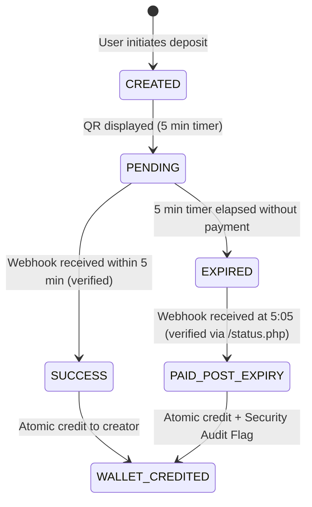

# Crazy Wallet — Security, Anti-Fraud & Cryptographic Integrity Architecture
**Author:** Security & Anti-Fraud Agent  
**Target Gateway:** XenPay (`https://xen-pays.space/api`)  
**Credentials:** 
- API Key: `pk_fd1be9df17b3c1e99c91faaa`
- API Secret: `sk_47908aa255f60d039201ff0045663e1c7a7c7262167d1c46` (Backend Only)

---

## 1. Webhook Security Architecture

### 1.1 The Threat Landscape
Attackers attempting to spoof payment success webhooks to artificially inflate wallet balances without paying.
Vectors:
1. **Payload Forgery:** Submitting counterfeit `{"status": "success", "amount": 50000}` payloads to the webhook URL.
2. **Timing Attacks:** Exploiting byte-by-byte string comparison (`===` or `==`) in signature verification to deduce secret bytes.
3. **Replay Attacks:** Intercepting a legitimate webhook and replaying it multiple times to credit the wallet multiple times.
4. **Body Parsing Distortion:** Express/Fastify/Next.js body parsers mutating raw bytes (JSON key reordering, unicode normalization, whitespace changes), leading to signature verification failures or vulnerabilities.

---

### 1.2 Strict Rule 1: Raw Body Preservation
**Rule:** The HMAC-SHA256 signature MUST be computed over the **exact, raw unparsed byte buffer** of the incoming HTTP request. Never parse JSON before HMAC calculation.

#### Implementation (Next.js App Router / Express)
```typescript
// Express configuration:
app.use('/api/webhook/xenpay', express.raw({ type: 'application/json' }));

// Next.js Route Handler (app/api/webhook/route.ts):
export async function POST(req: Request) {
  const rawBody = await req.text(); // raw UTF-8 string/buffer before JSON.parse
  // Compute HMAC over rawBody
}
```

---

### 1.3 Strict Rule 2: Constant-Time HMAC-SHA256 Verification
**Rule:** Use `crypto.timingSafeEqual` with byte buffers. Ensure buffer lengths match before calling `timingSafeEqual` to avoid length leakage errors.

#### Production Implementation (`security/webhook-verifier.ts`):
```typescript
import crypto from 'crypto';

export interface WebhookVerificationResult {
  isValid: boolean;
  error?: string;
}

export function verifyXenPaySignature(
  rawBody: string | Buffer,
  receivedSignature: string | null | undefined,
  apiSecret: string
): WebhookVerificationResult {
  if (!receivedSignature) {
    return { isValid: false, error: 'Missing X-Signature header' };
  }

  if (!apiSecret) {
    throw new Error('FATAL: XENPAY_API_SECRET is not configured on server');
  }

  // 1. Calculate HMAC-SHA256 hash using API Secret
  const hmac = crypto.createHmac('sha256', apiSecret);
  hmac.update(rawBody);
  const calculatedHex = hmac.digest('hex');

  // 2. Prepare Buffers for timing-safe comparison
  const receivedBuffer = Buffer.from(receivedSignature.trim(), 'hex');
  const calculatedBuffer = Buffer.from(calculatedHex, 'hex');

  // Buffer length check prevents timingSafeEqual from throwing RangeError
  if (receivedBuffer.length !== calculatedBuffer.length) {
    return { isValid: false, error: 'Signature length mismatch' };
  }

  // 3. Constant-time comparison
  const isValid = crypto.timingSafeEqual(receivedBuffer, calculatedBuffer);
  return {
    isValid,
    error: isValid ? undefined : 'Invalid signature hash',
  };
}
```

---

### 1.4 Strict Rule 3: Secondary Out-of-Band Status Check
**Rule:** Even if the webhook signature matches, **NEVER credit the wallet based on the webhook payload alone**. An attacker might have compromised a key or manipulated an intermediary proxy. Always query the XenPay status API directly over HTTPS before mutating balances.

#### Verification Flow:
1. Webhook arrives (`order_id`, `merchant_order_id`, `status`).
2. Verify HMAC signature.
3. Make server-to-server call:
   ```http
   GET https://xen-pays.space/api/status.php?order_id=<order_id>
   Headers:
     X-API-KEY: pk_fd1be9df17b3c1e99c91faaa
     X-API-SECRET: sk_47908aa255f60d039201ff0045663e1c7a7c7262167d1c46
   ```
4. Verify returned data matches:
   - `status === 'success'`
   - `amount == localOrder.amount`
   - `merchant_order_id == localOrder.id`
5. Only if all 4 checks pass, proceed to wallet credit.

---

### 1.5 Strict Rule 4: Webhook Replay Protection & Idempotency
**Rule:** Webhooks must be idempotent. If XenPay retries delivery 5 times for the same transaction, the wallet must be credited **strictly once**.

#### Database Table: `webhook_deliveries`
```sql
CREATE TABLE webhook_deliveries (
  id UUID PRIMARY KEY DEFAULT gen_random_uuid(),
  gateway VARCHAR(32) NOT NULL DEFAULT 'xenpay',
  event_id VARCHAR(128) NOT NULL, -- xenpay order_id
  merchant_order_id VARCHAR(80) NOT NULL,
  payload JSONB NOT NULL,
  status VARCHAR(32) NOT NULL, -- 'RECEIVED', 'PROCESSED', 'FAILED', 'DUPLICATE'
  processed_at TIMESTAMPTZ,
  created_at TIMESTAMPTZ NOT NULL DEFAULT NOW(),
  CONSTRAINT uq_webhook_event UNIQUE (gateway, event_id)
);
```

#### Idempotent Processing Logic:
```typescript
// Inside database transaction:
// 1. Try inserting the incoming event or locking the order row
const existing = await db.query(
  'SELECT status FROM orders WHERE id = $1 FOR UPDATE',
  [merchant_order_id]
);

if (!existing || existing.length === 0) {
  // Unknown order
  return res.status(404).json({ error: 'Order not found' });
}

if (existing[0].status === 'SUCCESS' || existing[0].status === 'CREDITED') {
  // Already processed! Acknowledge with 200 OK to stop retries, but DO NOT CREDIT AGAIN.
  return res.status(200).json({ status: 'already_processed' });
}
```

---

## 2. Wallet Concurrency, Double Withdrawals & Atomic Balance Updates

### 2.1 The "5 Clicks in 1 Second" Attack Vector
A creator has ₹1,000 balance. The creator submits 5 concurrent withdrawal requests for ₹1,000 simultaneously.
If the backend does:
```typescript
// VULNERABLE CODE (DO NOT USE):
const wallet = await db.findWallet(creatorId);
if (wallet.balance >= amount) {
  // Threat: 5 requests all read balance = 1000 at the same time!
  await db.updateBalance(creatorId, wallet.balance - amount);
  await processWithdrawal(amount);
}
```
**Outcome:** The creator withdraws ₹5,000 from a ₹1,000 balance, bankrupting the platform.

---

### 2.2 Strict Defense 1: Database Check Constraints
**Rule:** The database schema itself must reject negative balances at the engine level. No software bug can bypass this.
```sql
CREATE TABLE wallets (
  id UUID PRIMARY KEY DEFAULT gen_random_uuid(),
  creator_id UUID NOT NULL UNIQUE REFERENCES creators(id) ON DELETE CASCADE,
  balance_paise BIGINT NOT NULL DEFAULT 0,
  pending_withdrawal_paise BIGINT NOT NULL DEFAULT 0,
  created_at TIMESTAMPTZ NOT NULL DEFAULT NOW(),
  updated_at TIMESTAMPTZ NOT NULL DEFAULT NOW(),
  CONSTRAINT chk_wallet_balance_non_negative CHECK (balance_paise >= 0),
  CONSTRAINT chk_wallet_pending_non_negative CHECK (pending_withdrawal_paise >= 0)
);
```
*(Always store currency in **paise / cents** as integer `BIGINT` to prevent floating point imprecision).*

---

### 2.3 Strict Defense 2: Atomic Conditional SQL Deductions
**Rule:** Mutate balance using atomic SQL conditions. If the condition `balance_paise >= amount` fails, zero rows are updated, and the transaction is aborted.

```sql
-- Atomically lock and deduct available balance, moving it to pending_withdrawal
UPDATE wallets
SET 
  balance_paise = balance_paise - :amount_paise,
  pending_withdrawal_paise = pending_withdrawal_paise + :amount_paise,
  updated_at = NOW()
WHERE 
  creator_id = :creator_id 
  AND balance_paise >= :amount_paise
RETURNING balance_paise, pending_withdrawal_paise;
```
If `rowCount === 0`, throw `InsufficientBalanceError`.

---

### 2.4 Strict Defense 3: Pessimistic Locking (`SELECT FOR UPDATE`)
When executing a multi-step withdrawal workflow in a SQL transaction:
```sql
BEGIN;
  -- Lock the single wallet row against all concurrent writes
  SELECT balance_paise, pending_withdrawal_paise 
  FROM wallets 
  WHERE creator_id = $1 
  FOR UPDATE;

  -- Verify balance and insert withdrawal record
  INSERT INTO withdrawal_requests (
    id, creator_id, amount_paise, net_payout_paise, admin_fee_paise, status, idempotency_key
  ) VALUES (...);

  UPDATE wallets 
  SET balance_paise = balance_paise - $2, pending_withdrawal_paise = pending_withdrawal_paise + $2
  WHERE creator_id = $1;
COMMIT;
```

---

### 2.5 Strict Defense 4: Client & Request Idempotency Keys
**Rule:** Every withdrawal submission from the UI must attach a unique UUID `idempotency_key` generated on form mount.
- Table `withdrawal_requests` has a `UNIQUE (idempotency_key)` constraint.
- Rapid duplicate clicks replay the same key and are immediately rejected with `409 Conflict` or return the original in-flight request without re-executing deduction.

---

### 2.6 Strict Defense 5: Immutable Double-Entry Ledger
Never store balance solely as a mutable scalar. Every balance change must have an accompanying entry in `wallet_transactions`.
```sql
CREATE TYPE transaction_type AS ENUM (
  'DEPOSIT_CREDIT', 
  'WITHDRAWAL_RESERVE', 
  'WITHDRAWAL_PAID', 
  'WITHDRAWAL_REJECTED_REFUND', 
  'ADMIN_FEE', 
  'GATEWAY_FEE'
);

CREATE TABLE wallet_ledger (
  id UUID PRIMARY KEY DEFAULT gen_random_uuid(),
  wallet_id UUID NOT NULL REFERENCES wallets(id),
  transaction_type transaction_type NOT NULL,
  amount_paise BIGINT NOT NULL, -- positive for credits, negative for debits
  running_balance_paise BIGINT NOT NULL,
  reference_order_id VARCHAR(80),
  reference_withdrawal_id UUID,
  description TEXT,
  created_at TIMESTAMPTZ NOT NULL DEFAULT NOW()
);
```

---

## 3. QR Expiry & Late Payments (The 5:05 Minute Problem)

### 3.1 The Scenario
- Customer opens deposit page. A dynamic UPI QR is created with a 5-minute countdown.
- At minute 4:50, customer scans QR.
- At minute 5:02, local frontend timer hits 0:00 and displays "Expired! Do not pay."
- At minute 5:05, customer enters their UPI PIN and bank settles payment.
- XenPay captures the funds and dispatches a webhook to Crazy Wallet.

### 3.2 Security & Financial Policy
| Decision | Evaluation | Conclusion |
|---|---|---|
| **Drop webhook / Reject money** | XenPay already settled the money into merchant wallet! Dropping means customer lost money, merchant kept it, creator got nothing = **Fraud / Chargeback risk**. | ❌ REJECTED |
| **Silent drop** | Severe accounting imbalance. | ❌ REJECTED |
| **Honor Payment with Post-Expiry Flagging** | XenPay settled real funds. Verify with `/api/status.php`. If valid, fulfill order, credit creator wallet, and audit log as `PAID_POST_EXPIRY`. | ✅ ADOPTED |

### 3.3 State Machine for Deposit Orders


#### Code Implementation:
```typescript
// Handle order transition on verified webhook:
if (order.status === 'EXPIRED') {
  console.warn(`[SECURITY AUDIT] Late payment received for expired order ${order.id}. Fulfilling safely.`);
  
  await db.transaction(async (tx) => {
    // 1. Mark order as PAID_POST_EXPIRY
    await tx.orders.update({
      where: { id: order.id },
      data: { status: 'PAID_POST_EXPIRY', settled_at: new Date() }
    });

    // 2. Credit creator wallet with calculated net amount
    await creditCreatorWallet(tx, order.creator_id, order.amount_paise);

    // 3. Log audit event
    await tx.security_logs.create({
      data: {
        event: 'LATE_QR_PAYMENT_HONORED',
        order_id: order.id,
        creator_id: order.creator_id,
        gateway_order_id: xenPayOrderId,
        details: { delay_seconds: Math.floor((Date.now() - order.expires_at.getTime()) / 1000) }
      }
    });
  });
}
```

---

## 4. Fee Calculations & Mathematical Precision (Preventing Rounding Leaks)

### 4.1 Fee Rules
1. **XenPay Cost:** 14% + ₹10
2. **Crazy Wallet Admin Charge:** 20% + ₹15
3. **Crazy Wallet Net Margin (Spread):** 6% + ₹5

### 4.2 Integer Arithmetic in Paise (No Float Errors)
```typescript
export interface FeeBreakdown {
  grossAmountPaise: bigint;
  xenpayFeePaise: bigint;
  adminChargePaise: bigint;
  creatorReceivesPaise: bigint;
  platformProfitPaise: bigint;
}

export function calculateDepositFees(grossAmountRupees: number): FeeBreakdown {
  const grossPaise = BigInt(Math.round(grossAmountRupees * 100));

  // XenPay fee: 14% + 10 INR = (gross * 1400n) / 10000n + 1000n paise
  const xenpayFeePaise = (grossPaise * 1400n) / 10000n + 1000n;

  // Admin charge: 20% + 15 INR = (gross * 2000n) / 10000n + 1500n paise
  const adminChargePaise = (grossPaise * 2000n) / 10000n + 1500n;

  if (adminChargePaise >= grossPaise) {
    throw new Error('Deposit amount too small to cover transaction fees');
  }

  // Net creator receives in wallet: gross - admin charge
  const creatorReceivesPaise = grossPaise - adminChargePaise;

  // Platform net profit: admin charge - xenpay fee
  const platformProfitPaise = adminChargePaise - xenpayFeePaise;

  return {
    grossAmountPaise: grossPaise,
    xenpayFeePaise,
    adminChargePaise,
    creatorReceivesPaise,
    platformProfitPaise,
  };
}
```

---

## 5. Access Control & API Isolation

### 5.1 Role-Based Access Control (RBAC) Matrix
| Resource / Action | Public / Guest | Creator | Admin |
|---|---|---|---|
| View Deposit QR Page | ✅ (by order token) | ✅ | ✅ |
| View Wallet Balance | ❌ | ✅ (Own Only) | ✅ (All) |
| Request Withdrawal | ❌ | ✅ (Own Only) | ❌ |
| Approve/Reject Withdrawal | ❌ | ❌ | ✅ |
| View XenPay Gateway Balance | ❌ | ❌ | ✅ |
| View Global Platform Profit | ❌ | ❌ | ✅ |
| Receive Webhook | ✅ (HMAC Verified) | ❌ | ❌ |

### 5.2 Strict Multi-Tenancy Query Isolation
**Rule:** Under no circumstance should a client request pass `creator_id` to query their own balance or history.
- **Vulnerable:** `GET /api/wallet?creator_id=123` ❌ (Allows BOLA / IDOR attack).
- **Secure:** `GET /api/wallet` with JWT/Session cookie. Backend extracts `const creatorId = req.user.id`.
```typescript
// All DB queries MUST be bound to authenticated session
const wallet = await db.wallets.findUnique({
  where: { creator_id: session.user.id } // NEVER req.body.creator_id
});
```

### 5.3 Admin Guard Middleware
```typescript
export async function requireAdmin(req: AuthenticatedRequest, res: Response, next: NextFunction) {
  if (!req.user || req.user.role !== 'ADMIN') {
    return res.status(403).json({
      error: 'FORBIDDEN_ACCESS',
      message: 'Access restricted to platform administrators only.'
    });
  }
  next();
}
```

### 5.4 Secret Key Isolation (Zero-Leakage Guarantee)
- `XENPAY_API_KEY`: Server environment variable only (`process.env.XENPAY_API_KEY`).
- `XENPAY_API_SECRET`: Server environment variable only (`process.env.XENPAY_API_SECRET`).
- **NEVER** prefix with `NEXT_PUBLIC_` or `VITE_` or expose in Next.js client bundles.
- Add `.env` and `.env.local` to `.gitignore`.

---

## 6. End-to-End Security Verification Checklist

- [ ] Webhook computes HMAC over `rawBody`, not parsed JSON.
- [ ] Comparison uses `crypto.timingSafeEqual` with byte length check.
- [ ] Webhook triggers direct GET `/api/status.php` out-of-band verification.
- [ ] Database enforces `CHECK (balance_paise >= 0)`.
- [ ] Withdrawal uses atomic `UPDATE ... WHERE balance_paise >= amount` or `SELECT FOR UPDATE`.
- [ ] Withdrawal requests enforce UI `idempotency_key` deduplication.
- [ ] Late payments at minute 5:05 are safely verified, credited, and tagged `PAID_POST_EXPIRY`.
- [ ] All financial math uses integer `paise` (no floating-point rounding bugs).
- [ ] Creator endpoints derive user ID strictly from validated session, preventing IDOR.
- [ ] Admin routes are protected with strict role verification.
- [ ] `XENPAY_API_SECRET` is completely absent from all client bundles and public repositories.
